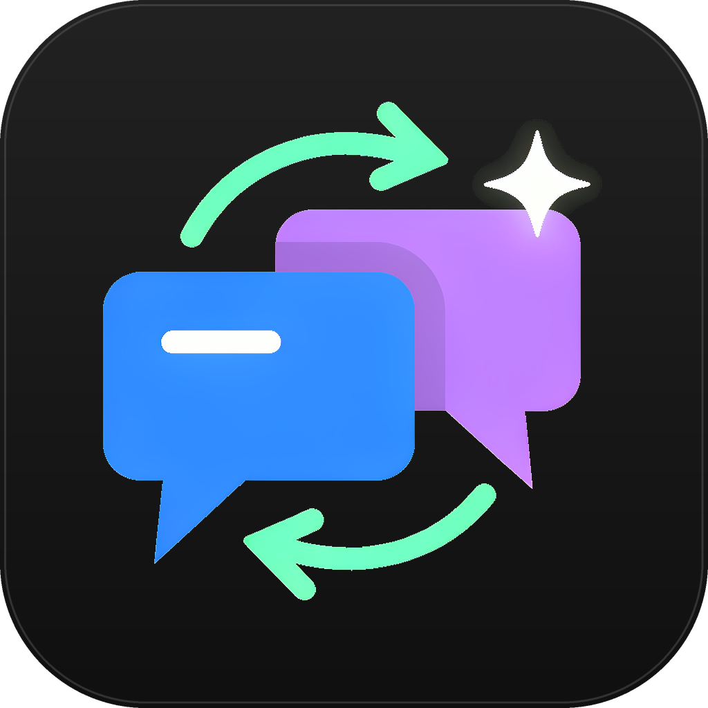

# 聊天软件 AI 转发助手

<p align="center"></p>

> Chat AI Forwarder · Windows 单文件桌面工具 · 本地运行，不上传数据

把聊天软件窗口里的新消息自动转发给**任意 AI 桌面客户端**，再把 AI 的回复自动回发到聊天窗口。
全程只在本机模拟鼠标 / 键盘 / 剪贴板操作，不调用任何网络接口，不依赖任何聊天软件的私有接口。


---

## 为什么需要它

同时开着聊天窗口和 AI 客户端时，手动复制、切换、粘贴、等待、再复制回来非常繁琐。
本工具把这条链路变成一条可校准、可分步验证、可随时暂停的本地自动化流水线。

- **通用**：不绑定某一家聊天软件或 AI 产品，所有交互位置由用户自己拖拽定位。
- **可读**：每条消息的处理过程都有日志，但只记录长度与不可逆指纹，不记录正文。
- **可控**：提供三种运行模式和四个单步测试按钮，校准阶段可以完全不发送任何内容。
- **可发布**：单文件 EXE、零核心依赖、源码内不含任何本机路径或用户数据。

---

## 快速开始

### 方式一：直接运行（推荐）

从 [Releases](https://github.com/KILLSTARSX/Chat-AI-Forwarder/releases) 下载 `聊天软件AI转发助手.exe`，双击即可。
无需安装 Python，无需安装运行库，无需管理员权限。

### 方式二：从源码运行

```bash
pip install -r requirements.txt
python src/chat_ai_forwarder.py
```

核心功能**不需要** `requirements.txt` 里的任何包；列出的都是可选增强项。

---

## 五步完成配置

| 步骤 | 操作 | 说明 |
| --- | --- | --- |
| 1 | 打开窗口 | 打开并登录聊天软件与 AI 客户端，保持窗口可见、不要最小化 |
| 2 | 白名单（可选，默认为空） | 不预设任何目标窗口，可整步跳过；需要防误点时再到「高级 / 隐私」添加 |
| 3 | 摆放定位点 | 「定位校准」→ 把 7 个圆形准星拖到对应位置；**找不到准星时把鼠标移到目标附近，双击对应步骤行即可唤回** |
| 4 | 框出检测区 | 蓝框＝聊天消息列表，紫框＝AI 回复正文区域；左上角标签拖动、右下角 ↘ 调整大小，也可用「移到鼠标」按钮 |
| 5 | 单步验证再启动 | 「快速上手」→ 依次点 ①②③④ 测试 → 确认无误后点「▶ 启动」 |

> 目标窗口白名单**默认留空**：程序不自动识别、不预设任何窗口，留空时只按准星坐标定位。
>
> 建议先把运行模式切到 **「仅检测」**：该模式不执行任何鼠标键盘操作，
> 只统计检测区的变化次数，可安全验证检测框是否摆对。

### 七个定位点

| 准星 | 位置 | 用途 |
| --- | --- | --- |
| ① 聊天消息 | 聊天窗口最新一条消息 | 在此处右键 |
| ② 右键菜单·复制 | 弹出菜单的「复制」项 | 读取消息文本 |
| ③ AI 输入框 | AI 客户端输入框 | 粘贴消息 |
| ④ AI 发送 | AI 客户端发送按钮 | 提交给 AI |
| ⑤ AI 复制回复 | AI 回复下方的「复制」按钮 | 读取回复 |
| ⑥ 聊天输入框 | 聊天窗口输入框 | 粘贴回复 |
| ⑦ 聊天发送 | 聊天窗口发送按钮 | 回发回复 |

---

## 工作流程

```
检测区画面变化
   ↓ 变化比例超过阈值（过滤光标闪烁等噪声）
读取新消息（复制粘贴 / 界面控件 / OCR，失败自动回退）
   ↓ 指纹去重 + 冷却检查
转发到 AI 输入框并发送
   ↓
等待回复：回复区「先出现变化」→「连续稳定 N 秒」→「超过最短等待」
   ↓
点击 AI 复制按钮 → 读取剪贴板 → 与上轮回复比对去重
   ↓
回发到聊天窗口 → 重新采集检测区基准
```

**回复判定是本次重构的重点。** 旧版通过「复制按钮像素相似度」判断回复是否完成，
按钮从头到尾都在时会在稳定后立刻触发，容易复制到上一轮的旧回复。
新版改为回复区域的**变化 → 稳定状态机**：必须观测到区域确实发生过变化，
且随后连续稳定、并超过最短等待时间，才认为生成结束；超时则直接放弃本轮，绝不误发旧内容。

---

## 运行模式

| 模式 | 行为 |
| --- | --- |
| 双向转发 | 完整链路：消息 → AI → 回复 → 聊天 |
| 仅转发到 AI | 只把消息送进 AI，不等待、不回发 |
| 仅检测 | 只统计检测区变化，不做任何点击或输入 |

「快速上手」页提供四个独立的单步测试（读取 / 转发 / 取回复 / 回发），
任何一环出问题都能单独复现，不必跑完整循环。

---

## 隐私设计

这一节是发布前的硬性要求，实现上做了以下约束：

- **不联网**：程序源码中没有任何 HTTP 客户端、遥测或更新检查；截图、OCR、识别全部本机完成。
- **不写消息正文**：日志默认只显示 `长度 N / #指纹`；指纹为 BLAKE2b 截断摘要，不可逆。
- **不写窗口标题**：需要关联窗口时只记录不可逆指纹，白名单标题只存在于本机配置文件。
- **默认不落盘**：文件日志默认关闭；即使开启，写入前也会统一抹去盘符路径、用户目录与网络路径。
- **不留临时文件**：剪贴板读写直接使用 Win32 `CF_UNICODETEXT`，不再启动 PowerShell、不再写临时文件。
- **零硬编码路径**：配置与日志目录在运行时从系统环境变量推导；源码、文档、构建脚本里没有任何绝对路径或用户名。
- **分发包干净**：仓库不包含任何用户配置、日志、截图、备份脚本或历史工程文件。

用户配置与日志保存在当前用户的漫游应用数据目录下的 `ChatAIForwarder/` 中，
不会随程序分发，也不会出现在仓库里。

> 提示：程序会临时占用系统剪贴板。默认开启「任务结束后恢复原有剪贴板内容」。

---

## 可选组件

核心功能只依赖 Windows API + tkinter + Python 标准库。以下均为可选：

| 组件 | 作用 | 启用方式 |
| --- | --- | --- |
| `uiautomation` | 界面控件识别（不点右键直接读文本） | `pip install uiautomation`，从源码运行时自动检测 |
| OCR | 图像文字识别 | 单文件 EXE 不含推理引擎；需要时把 OCR 运行时放到 EXE 同级的 `ocr_runtime/` 目录 |
| `numpy` | 大区域像素比对加速 | 可选，未安装时自动使用标准库实现 |

单文件 EXE 刻意不包含 ONNX / OpenCV / OCR 模型（会让体积增加数百 MB 并显著拖慢冷启动）。
不需要 OCR 的用户无需任何额外操作。

---

## 从源码构建单文件 EXE

要求：Windows + Python 3.9+ + PyInstaller 6.x

```bash
pip install pyinstaller
build.bat
```

或手动执行：

```bash
python -m PyInstaller --noconfirm --clean ChatAIForwarder.spec
```

产物：`dist/聊天软件AI转发助手.exe`（单文件，无需附带任何 DLL 或数据目录）。

`build.bat` 使用 `%~dp0` 定位自身目录，不含任何绝对路径，可在任意机器上直接运行。

---

## 应用图标

图标与界面同为中性灰配色：深灰圆角底上，蓝色聊天气泡与紫色 AI 气泡通过绿色循环箭头相连，右上星芒代表 AI。

| 文件 | 用途 |
| --- | --- |
| `assets/logo.png` | 1024×1024 主图标，用于仓库 / 文档展示 |
| `assets/logo_transparent.png` | 透明底主体，适合浅色背景或再加工 |
| `assets/app.ico` | 16 / 24 / 32 / 48 / 64 / 128 / 256 多尺寸，已嵌入 EXE |

`ChatAIForwarder.spec` 同时做两件事：用 `icon=` 把图标写进 PE 资源（资源管理器 / 任务栏），
再用 `datas=` 把 `.ico` 带进单文件，供程序运行时通过 `iconbitmap()` 设置**窗口标题栏图标**与弹窗图标。
两者缺一，左上角就仍会显示 Tk 默认羽毛图标。状态栏右侧也用了同款迷你图标。
16px 下双气泡与循环箭头依然可辨。

---

## 常见问题

**Q：启动后没有反应？**
先切到「仅检测」模式，观察日志是否出现「检测区变化」。若没有，说明蓝框没框住消息区域或变化阈值过高；
可在「识别与检测」里调低「变化阈值」、调高「像素容差」。

**Q：一直提示跳过同一条消息？**
这是去重逻辑在生效。检测区被持续触发但消息未变时会命中指纹缓存，属正常行为。

**Q：点击打到了别的地方？**
勾选「启用窗口白名单校验」并添加两个窗口标题；第三方弹窗遮挡时点击会被拦截。
坐标是按屏幕绝对像素保存的，更换分辨率或多屏布局后请重新摆一次准星。

**Q：AI 回复没被复制？**
确认紫框确实框住回复正文、⑤ 准星对准「复制」按钮，并适当增大「稳定时长」与「等待上限」。

---

## 合法用途声明与风险警告

> ⚠️ **使用前请务必完整阅读本节。**

**仅限合法用途。** 本工具仅限在合法、合规的前提下，用于本人自有账号与自有内容的效率辅助。
**严禁**用于群发广告、骚扰、刷屏、诈骗、爬取他人数据、规避平台风控等任何违法违规或侵害他人权益的行为。
使用本工具即表示你已阅读并同意遵守适用法律法规及所用平台的用户协议；
由此产生的一切后果由使用者自行承担。

**账号风险警告。** QQ、微信等国内聊天软件对高频、机械化的鼠标键盘操作设有风控检测。
**高频率或长时间连续使用，可能导致账号被警告、限制登录、功能受限，甚至永久封号。**
请自行降低频率、控制单次使用时长并充分评估风险；
作者不对任何账号异常、封禁、数据丢失或第三方服务变更承担责任。

本项目与任何聊天软件、AI 产品厂商均无关联，也不提供任何规避平台风控的能力或建议。

---

## 作者与许可

- 作者：**KILL-STAR SX**
- 仓库：<https://github.com/KILLSTARSX/Chat-AI-Forwarder>
- 作者主页：<https://github.com/KILLSTARSX> —— **更多有趣实用项目都在里面**
- 许可：[MIT](LICENSE)

如果这个项目对你有用，欢迎 Star ⭐

---

## 维护状态

> **本项目暂时停止更新和维护。**

当前 v2.0.0 为最终发布版本，功能完整、可正常使用。
暂停期间不会新增功能、不会跟进第三方客户端的界面变化，也不会定期处理 Issue 与 Pull Request。
代码按 MIT 许可开放，如需继续演进可自行 Fork；日后若恢复更新，会在此处说明。
